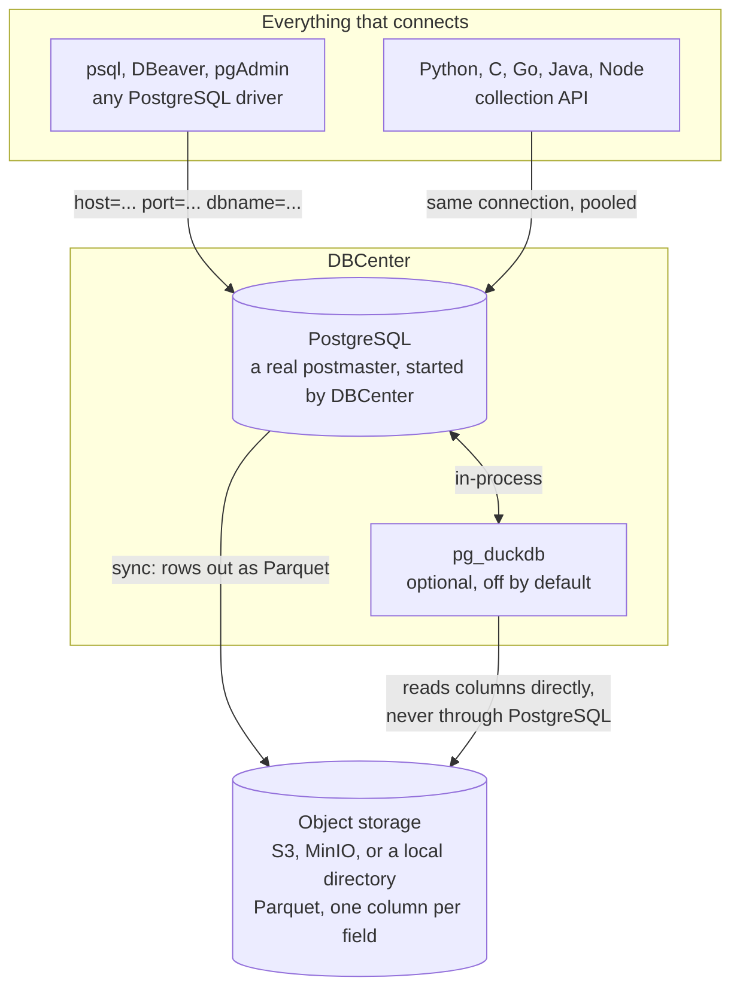
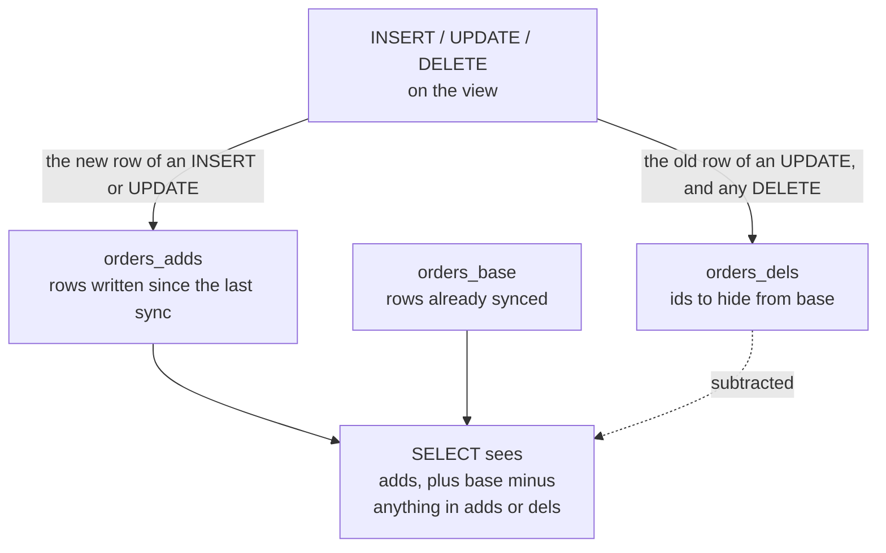
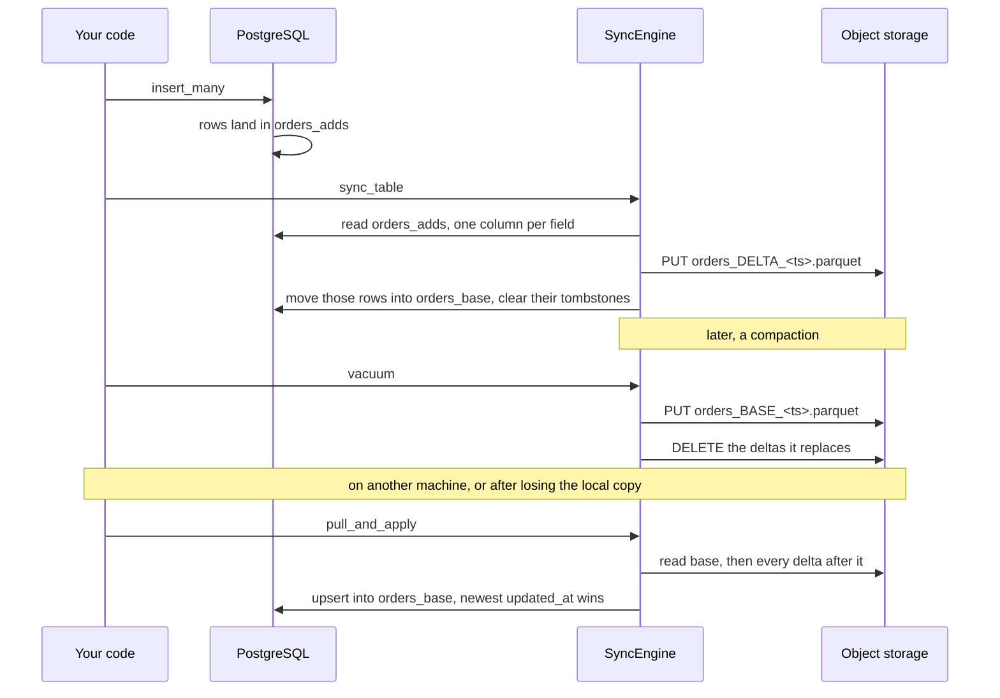
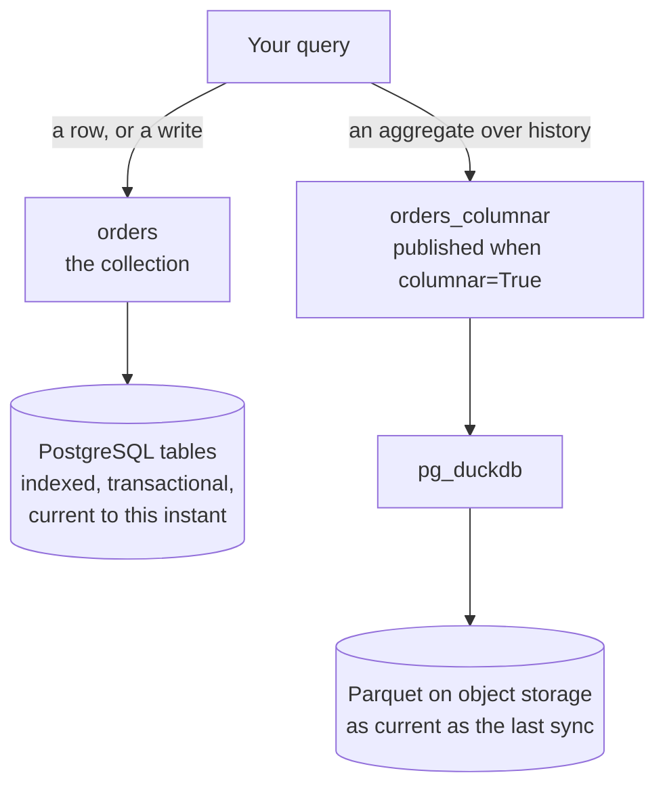
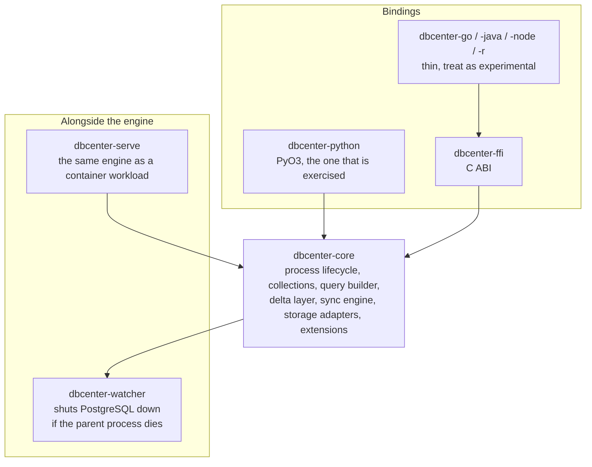

# DBCenter - Rust Edition

**PostgreSQL as a SQLite/MongoDB** - Embedded PostgreSQL with MongoDB-style API, now written in Rust for maximum performance and safety.

## Features

- 🚀 **Embedded PostgreSQL** - No external dependencies, runs locally
- 🔥 **MongoDB-style API** - Familiar NoSQL interface with PostgreSQL power
- 🌍 **Multi-language support** - C, Python, Go bindings
- 📊 **PostGIS** - Full geospatial database support
- ⚡ **High Performance** - Rust's zero-cost abstractions
- 🔒 **Memory Safe** - No segfaults, no data races
- 🎯 **Type Safe** - Compile-time guarantees

## Language Bindings

### Python
```python
from dbcenter import DBCenter

db = DBCenter(path="./data")
db.users.insert_one({"name": "Ali", "age": 25})
users = db.users.find({"age": {"$gt": 18}})
```

### C
```c
#include "dbcenter.h"

DBCenter* db = dbcenter_new("./data", true);
dbcenter_insert_one(db, "users", "{\"name\":\"Ali\",\"age\":25}");
```

### Go
```go
import "github.com/heyobi/dbcenter-go"

db := dbcenter.New("./data")
db.Collection("users").InsertOne(map[string]interface{}{
    "name": "Ali",
    "age": 25,
})
```

## Architecture

DBCenter starts a real `postgres` binary against a data directory and puts a
MongoDB-shaped API in front of it. Storage, planning and transactions are
PostgreSQL's; what DBCenter adds is the lifecycle, the delta layer, and a
columnar copy on object storage that can be read without going through
PostgreSQL at all.

The whole point is that none of that is visible from outside. A client is handed
an ordinary connection string.



The client sees PostgreSQL 18. It does not have to know that some of its data is
in a table and some of it is Parquet on a bucket somewhere.

### A collection is three tables and a view

In delta mode, `db.collection("orders")` is not a table. It is a view over a
base table, an additions table and a tombstone table, with `INSTEAD OF` triggers
that make it writable. This is what lets a sync ship only what changed, and what
lets two machines converge through a bucket neither of them owns.



A document's fields are ordinary columns. The first time a document carries a
field the table grows a column for it, so `orders` has `id`, `created_at`,
`updated_at` and then whatever the documents have made of it.

### Where the data goes, and how it comes back



The Parquet is written with **one column per document field**, with the type the
field had. That is not cosmetic. Serialising the document into a single JSON
column - which is what this used to do - leaves Parquet nothing to be columnar
about, and made reads off object storage *slower* than the PostgreSQL they were
meant to beat. See [docs/columnar-reads.md](docs/columnar-reads.md).

### Two read paths, deliberately not one

Reading five million rows, measured on one machine:

| | PostgreSQL | Parquet through DuckDB |
|---|---|---|
| `sum()` over a column | 586 ms | **46 ms** |
| `GROUP BY` | 2336 ms | **17 ms** |
| point lookup by id | **0.2 ms** | 38 ms |

Neither wins at both, so DBCenter keeps both and gives them separate names.



They are not merged into one view, and that is a decision rather than an
oversight. pg_duckdb takes a whole query or none of it, and DuckDB cannot use
PostgreSQL's indexes - so a view unioning the two sends *every* query through
DuckDB and turns a 0.1 ms point lookup into 55 ms. Measured, then discarded.

Turning the columnar path on is one flag:

```python
db = dbcenter.DBCenter(path="/data", multi_user_sync=True, columnar=True)
```

pg_duckdb is put in place before PostgreSQL starts, so there is no restart, and
`<name>_columnar` appears beside each collection as soon as there is something
synced to read. It is off by default because it takes the resident set from
about 128 MB to 250 MB, which a database that never runs an aggregate should not
pay.

### The crates



`dbcenter-watcher` exists because an embedded database whose host process is
killed would otherwise leave a postmaster running against the data directory.
It is compiled for the same target and embedded in the binding, then written out
at run time.

## Extensions

PostGIS, pgvector and pgsql-http are not part of the PostgreSQL distribution, so
they are downloaded on first use and unpacked into the local installation.

They come from [dbcenter-extensions](https://github.com/heyobi/dbcenter-extensions),
a public repository holding nothing but the builds. There used to be a CDN run by
the project, with a fixed `?token=admin-secret-key` compiled into every client -
a shared secret in everyone's binary, guarding a service that had to stay up or
the feature stopped existing. GitHub Releases needs no secret and no server.

The assets are in a separate repository because this one is private, and GitHub
serves release assets from a private repository only to authenticated callers -
which a user's machine, downloading anonymously, is not.

Because these archives are loaded into the database process, a substituted one
is arbitrary code execution. Every download is checked against a SHA-256 pinned
in `EXTENSION_CHECKSUMS` in `dbcenter-core/src/extensions.rs`, so the host
serving them is not trusted: a tampered asset fails to verify even if the
account publishing it is compromised. An asset with no pinned digest is refused.

| Variable | Meaning |
|---|---|
| `DBCENTER_EXTENSION_BASE_URL` | Fetch from a fork, a local server, or an offline mirror |
| `DBCENTER_ALLOW_UNVERIFIED_EXTENSIONS` | Accept an asset with no pinned digest. For publishing a new one, not for normal use |

### Publishing a build

1. Build the extension for the target PostgreSQL major version and platform, and
   archive it with the layout of the PostgreSQL installation (`lib/`, `share/`).
2. Name it `<name>-<version>-<platform>-pg<major>.<tar.gz|zip>`, e.g.
   `vector-0.8.1-linux-amd64-pg18.tar.gz`. The name is the whole address -
   release assets are a flat namespace.
3. Upload it to the `extensions-v1` release on `dbcenter-extensions`.
4. Add its `sha256sum` to `EXTENSION_CHECKSUMS` and record the PostgreSQL major
   version range in the table for that extension. Skipping this leaves the asset
   unusable, which is the intended failure direction, and
   `every_offered_version_has_a_published_asset` fails if a table offers a
   version with no asset behind it.

Check that an archive actually contains a loadable module - `.so` on Linux,
`.dll` on Windows - before publishing it. One pgvector build shipped
`lib/vector.lib`, an import library, and passed every archive-integrity check
while being unusable: it installed cleanly and then failed at CREATE EXTENSION.

A build for an older major version is not a fallback: PostgreSQL stamps every
loadable module with the major version it was compiled against and refuses to
load one that disagrees. Asking for a PostgreSQL that has no published build is
an error naming the newest one that exists, rather than a download that fails
later with "incompatible library".

## Running as a container

The engine is meant to be embedded in a process, with object storage holding
the durable copy. That is also the shape a scale-to-zero platform wants: the
machine is disposable, the bucket is not.

`dbcenter-serve` supplies the lifecycle. On boot it restores every table it
finds in the bucket, then starts PostgreSQL on TCP so ordinary clients - psql,
DBeaver, any driver - connect straight to it. While running it pushes pending
changes periodically, and on SIGTERM it pushes whatever is left before shutting
down, so nothing written since the last pass is lost when the machine stops.

The image ships with the PostgreSQL distribution already unpacked, so a cold
start does not wait on a 60MB download from Maven Central, and it starts with
no network access at all.

```bash
docker build -t dbcenter .

docker run --rm -p 5432:5432 \
  -e DBCENTER_STORAGE=s3 \
  -e DBCENTER_BUCKET=my-bucket \
  -e AWS_ENDPOINT_URL_S3=https://fly.storage.tigris.dev \
  -e AWS_ACCESS_KEY_ID=... -e AWS_SECRET_ACCESS_KEY=... \
  -e DBCENTER_PASSWORD=... \
  -e DBCENTER_COLLECTIONS=users,orders \
  dbcenter
```

| Variable | Default | Meaning |
|---|---|---|
| `DBCENTER_STORAGE` | `none` | `s3`, `local` or `none` |
| `DBCENTER_BUCKET` | `$BUCKET_NAME` | Bucket holding the durable copy |
| `DBCENTER_PREFIX` | *(none)* | Key prefix, so several databases share a bucket |
| `DBCENTER_DATA_DIR` | `/data/db` | Local cluster directory |
| `DBCENTER_LISTEN` | `*` | TCP bind address; empty disables TCP |
| `DBCENTER_PORT` | `5432` | |
| `DBCENTER_PASSWORD` | *(none)* | Required for TCP clients; without it only the local socket is usable |
| `DBCENTER_COLLECTIONS` | *(none)* | Comma-separated collections to create at boot |
| `DBCENTER_SYNC_INTERVAL_SECS` | `30` | How often to push pending changes |
| `DBCENTER_PULL` | `false` | Also take in other nodes' changes each pass |
| `DBCENTER_COMPACT_INTERVAL_SECS` | `900` | Fold deltas into a fresh base snapshot; `0` disables |
| `DBCENTER_NODE_ID` | `$FLY_MACHINE_ID` | Identifies this writer in storage locks |

`AWS_ACCESS_KEY_ID`, `AWS_SECRET_ACCESS_KEY`, `AWS_REGION` and
`AWS_ENDPOINT_URL_S3` are read the same way every other S3 tool reads them, so
`fly storage create` and `aws configure` both just work.

### Fly.io

`fly.toml` sets `auto_stop_machines` with `min_machines_running = 0`: with no
connections Fly stops the machine and the bill goes to nothing, and the next
client to connect starts it again. The volume is a warm cache that saves
re-running `initdb` on wake, not the source of truth - losing it costs time,
not data.

### Checking it locally

`docker-compose.yml` stands MinIO in for Tigris and runs two nodes against one
bucket.

`scripts/cluster-test.sh` covers the scale-to-zero case: it writes through one
node, destroys that node and its disk, and checks the row comes back on the
other. That is the claim that the machine is disposable.

`scripts/convergence-test.sh` covers the horizontal case, with both nodes live:
each writes a row of its own, and both end up with both. It first checks that
the nodes *disagree* before syncing, so a pass cannot come from them sharing
state some other way.

```bash
./scripts/cluster-test.sh
./scripts/convergence-test.sh
```

### More than one writer

`DBCENTER_PULL` is off by default. A single scale-to-zero machine restores once
at boot and is then the only writer, so pulling again buys nothing. Turn it on
when several nodes share a bucket.

Conflict resolution is last-write-wins on `updated_at`, so two nodes editing the
same row concurrently keep the later edit and lose the earlier one. That is fine
for append-heavy and partitioned workloads and wrong for a shared counter.

Compaction takes the storage lock, so with several nodes running exactly one
does the work and the others move on. Without it every push leaves another
Parquet object behind and cold starts get slower without bound.

## Building

```bash
# Core library
cargo build --release -p dbcenter-core

# Python bindings
cd dbcenter-python
maturin build --release

# C library
cargo build --release -p dbcenter-ffi
```

## Performance

Rust implementation provides:
- **3-5x faster** startup time
- **2x lower** memory footprint
- **Zero-cost** abstractions
- **Safe concurrency** with no data races

## Original Python Version

This is a Rust rewrite of the original Python dbcenter library, maintaining API compatibility while adding performance and safety.
